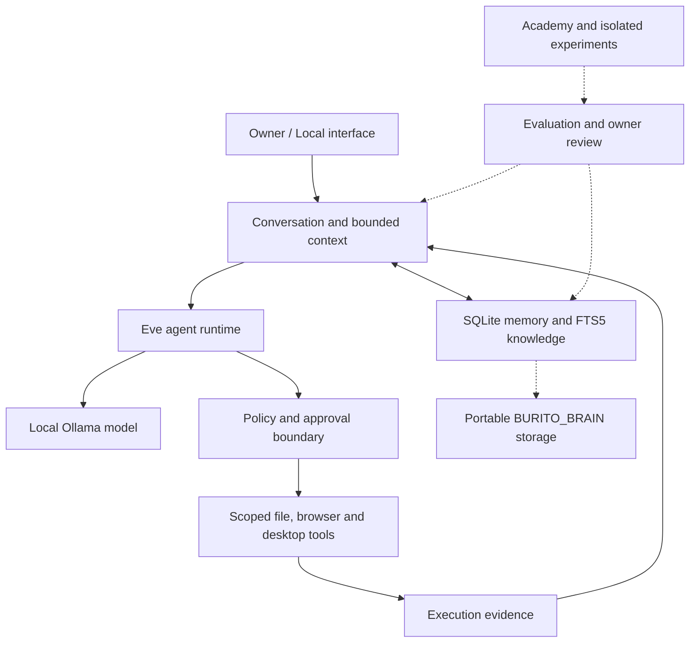

# Burito

**A local-first cognitive companion for personal computing.**

[](https://github.com/Bishrav/Burito/actions/workflows/tests.yml)


[Get started](#getting-started) · [Architecture](#system-architecture) · [Research](#research-program) · [Roadmap](#development-roadmap) · [Security](#security-and-privacy)

> **From answering questions to maintaining context, acquiring knowledge, and performing verified computer work.**

Burito is an independent AI engineering and research project exploring how a personal assistant can combine local language-model inference, persistent knowledge, natural conversation and explicitly authorized computer tools. The goal is a dependable digital companion that understands its owner's projects, learns from evidence, and earns greater autonomy through demonstrated reliability.

Burito is not a finished AGI system, a conscious digital human, or an unrestricted computer-control agent. It is an evolving, test-driven platform for investigating those functional capabilities that make personal computing assistance useful.

## Why Burito?

A language model alone does not provide durable memory, reliable execution, or verifiable learning. Burito treats these as separate engineering problems:

| Design principle | Objective |
| --- | --- |
| Local-first intelligence | Keep routine inference and private context on the owner's machine. |
| Cognitive continuity | Preserve useful context across conversations, projects and restarts. |
| Evidence before confidence | Separate observations, owner statements, hypotheses and verified outcomes. |
| Earned autonomy | Expand permissions through explicit authorization and tested skills, not model confidence. |
| Portable knowledge | Separate durable data from runtime code and replaceable model weights. |
| Measurable improvement | Compare experiments to reproducible baselines before deployment. |

## Current capabilities

This table includes the Phase 3 feature branch, which is not yet released to
`main`. See the [development log](docs/DEVELOPMENT_LOG.md) and
[status](docs/STATUS.md) for evidence and limitations.

| Capability | Development status |
| --- | --- |
| Local LLM inference via Ollama and Eve | Live local exchange verified |
| Loopback web chat, streaming, Stop and Retry | Live Brave checks reported |
| Conversation history, search and restart recovery | Synthetic persistent database verified |
| Personal facts, glossary and local knowledge library | Implemented; personal context is opt-in |
| Scoped file reads and application discovery | Implemented and tested |
| Approved application launches and Hyprland window focus | Host checks reported |
| KWin desktop support | Regression-tested; live checks outstanding |
| Optional Brave page and tab tools | Implemented with per-action approval; live coverage varies |
| Optional online research | Explicit query approval; provider coverage incomplete |
| Beginner lesson catalog and owner feedback | Implemented; not neural model training |
| Advanced cognitive memory and portable brain integration | Schema-v2 memory, project continuity, experience records, non-executable skill proposals and Academy progress; synthetic and isolated brain checks passed |
| Mathematical and classical ML teaching code | Tested CPU implementations; isolated intent model did not beat the deterministic baseline and is not in production |
| Voice, vision, paired mobile access and durable workflows | Planned |
| Specialist agents and continual model improvement | Research roadmap |

## System architecture

The following conceptual diagram separates existing foundations from the broader design. Not every path in the target architecture is implemented.



**Solid edges** represent the foundation; **dashed edges** represent integration or research objectives requiring further verification.

The architecture uses Python for local data, diagnostics and host integration; TypeScript and Eve for the agent runtime; SQLite/FTS5 for memory and text retrieval; and Ollama for local inference. The browser extension provides scoped Brave integration. Hyprland and KWin adapters isolate compositor-specific behavior.

### Cognitive operating cycle

`Perceive → Understand → Retrieve → Reason → Plan → Authorize → Act → Verify → Reflect → Learn`

This is a design objective, not a claim that every stage is already implemented. In particular, a proposed plan is not an executed action, and an executed action is not a verified success.

See [architecture](docs/ARCHITECTURE.md), [cognitive architecture](docs/COGNITIVE_ARCHITECTURE.md) and [digital companion vision](docs/DIGITAL_HUMAN_VISION.md).

## Research program

Burito investigates three connected research questions:

| Research question | Baseline and evaluation direction |
| --- | --- |
| Can a local assistant maintain useful context over time? | SQLite/FTS5 retrieval; measure recall, ranking, correction, deletion and restart continuity. |
| Can an assistant convert experience into dependable skills? | Owner-reviewed procedures; measure task success, failure recovery, authorization and repeatability. |
| Can specialized learning improve a general assistant without weakening safety? | Compare deterministic and small ML baselines; evaluate held-out performance, resource cost, regression and rollback. |

The research is inspired by cognitive architectures such as [ACT-R](https://act-r.psy.cmu.edu/) and [Soar](https://soar.eecs.umich.edu/). These are research references, not claims that Burito implements those systems.

### Burito Academy

The Academy is a parallel, expandable research and education track. Its curriculum covers:

- Mathematics, probability, statistics, optimization, algorithms and computer science.
- Classical machine learning: regression, classification, clustering, ensembles, evaluation and uncertainty.
- Deep learning: neural networks, backpropagation, CNNs, sequence models, attention, transformers and generative models.
- NLP, vision, speech, reinforcement learning, knowledge graphs, causal reasoning and multi-agent systems.
- Continual learning, parameter-efficient adaptation, interpretability, safety and research methodology.

Modules are intended to include source provenance, prerequisites, mathematical explanation, reproducible implementations, exercises, tests and measurable completion criteria. Candidate references include [Stanford CS229](https://see.stanford.edu/Course/CS229), [MIT 6.036](https://ocw.mit.edu/courses/6-036-introduction-to-machine-learning-fall-2020/) and [PyTorch tutorials](https://docs.pytorch.org/tutorials/).

Retrieving knowledge is not training a neural network. Storing a lesson is not evidence of mastery. Production deployment of learned models requires evaluation and review.

Read the [Academy plan](docs/AI_ACADEMY.md).

### Portable brain

The intended storage hierarchy separates GPU inference, RAM working context, internal SSD runtime/caches and external durable storage. The dedicated brain is designed to preserve personal memory, knowledge, project history, experience, approved skills, research artifacts and model checkpoints independently of a particular model or operating system.

A 4 TB external ext4 volume is the reference design. The Phase 3 branch has a
UUID-checked manifest, transactional schema-v2 migration, project continuity,
evidence-based experience records, non-executable skill proposals and
persistent Academy progress. Synthetic project continuity was verified across
separate processes. Six Academy progress records are present on the brain. A
checksummed SQLite backup to the separate internal NVMe and isolated restoration
passed, including integrity and record-count checks; this is not an off-machine
backup. Automatic mounting after a physical reboot remains unverified. No
private memories have been migrated. Do not format an existing disk to follow
this README.

See [brain storage and recovery](docs/BRAIN_STORAGE.md). A snapshot on the same disk is not an independent backup.

## Research evidence and reproducibility

The published [Phase 2 development log](docs/DEVELOPMENT_LOG.md) reports the following local evaluation using Qwen3 8B, Ollama 0.40.18 and an 8,192-token context:

| Metric | Reported result |
| --- | ---: |
| Median time to first visible text | 113 ms |
| Median complete reply arrival | 704 ms |
| Median generation throughput | 93.0 tokens/s |
| Live synthetic conversation scenarios | 16 passed |
| Python tests | 69 each on Python 3.11 and 3.14 |
| Node tests | 8 passed |

These are development measurements, not independently replicated benchmarks. Timing used three matched prompts; prompt and reasoning settings differed between phases. They do not establish general model quality or guarantee performance on other hardware. Private brain startup, physical reboot and live KWin remained unverified in that evaluation.

Future experiments should publish versioned synthetic or licensed fixtures, model/configuration details, hardware, data splits, seeds, latency distributions, task outcomes, limitations and safety regressions. Private owner data must never be included in public evaluation fixtures.

## Getting started

Burito is development-stage Linux software, not a one-click consumer release.

**Prerequisites:** Git, Python 3.11 or 3.14, Node.js 24+ (CI uses 26), npm, SQLite with FTS5, and an accessible local Ollama server. Optional desktop tools require the appropriate Wayland compositor and browser configuration.

The reference host is Ryoku/CachyOS with Hyprland, an Intel Core i9-14900K, RTX 5070 (12 GB VRAM) and 32 GB RAM. This is a development configuration, not a minimum hardware requirement.

### 1. Clone and check the runtime

```bash
git clone https://github.com/Bishrav/Burito.git
cd Burito
python3 scripts/check-source-integrity.py
python3 -m burito doctor
bash scripts/setup-runtime.sh
```

See the [Ryoku setup](docs/RYOKU_SETUP.md) and [first conversation guide](docs/FIRST_CHAT.md) for dependency installation and platform-specific details. Some historical notes describe earlier revisions.

### 2. Configure local inference

Install Ollama using its [official instructions](https://docs.ollama.com/linux) if not already installed. With the local server running, use the model configuration expected by the checked-in desktop launcher:

```bash
ollama pull qwen3:8b
ollama create burito-local:latest -f config/ollama/Modelfile
ollama list
```

The model is downloaded separately and not distributed in this repository. Check available memory before downloading or increasing context. Existing installations may use another alias; follow the runtime configuration and avoid duplicating weights unnecessarily.

### 3. Explore local memory and chat

The standard desktop launcher expects the verified BURITO_BRAIN ext4 volume
mounted at `/mnt/burito-brain`; durable memory uses
`/mnt/burito-brain/memory`. The runtime verifies the configured brain identity
and refuses a local fallback when the expected brain is unavailable. Never
format or repartition an existing brain disk to follow this README.

```bash
python3 -m burito --help
./scripts/start-chat.sh
```

Press Ctrl+C to exit. Personal facts are excluded from the ordinary launcher context unless explicitly requested with `--include-personal`. Sensitive tool use remains approval-gated. Follow [PC access setup](docs/PC_ACCESS.md) for Brave and desktop integration.

### 4. Run the verification suite

```bash
python3 scripts/check-source-integrity.py
python3 -m unittest discover -s tests -v
(
  cd runtime
  npm ci --no-audit --no-fund
  EVE_TELEMETRY_DISABLED=1 EVE_TRACES_CONTENT=off npm run check:discovery
  npm test
)
```

The [GitHub Actions workflow](.github/workflows/tests.yml) defines the automated checks. Passing CI is not equivalent to passing real-device acceptance tests.

## Repository guide

| Path | Responsibility |
| --- | --- |
| `burito/` | Python CLI, memory, knowledge, diagnostics and host services |
| `runtime/` | Eve agent, TypeScript tools and browser integration |
| `ui/` | Local conversation interface |
| `curriculum/` | Versioned educational seed material |
| `config/ollama/` | Local model serving configuration |
| `scripts/` | Setup, launch and verification utilities |
| `tests/` | Python regression tests |
| `docs/` | Design, experiments, security, setup and status |
| `AGENTS.md` | Engineering and agent development instructions |

## Development roadmap

| Phase | Milestone | Direction |
| ---: | --- | --- |
| 0 | Recovery | Source integrity and repeatable tests |
| 1 | Ryoku integration | Local web and desktop foundations |
| 2 | Natural conversation | Streaming, interruptions and continuity |
| 3 | Cognitive memory | Durable brain, retrieval, experiences and skills |
| 4 | Voice and vision | Visible, consent-based multimodal interaction |
| 5 | Mobile and remote | Secure pairing and remote non-GUI tasks |
| 6 | Durable workflows | Checkpoints, cancellation and verified outcomes |
| 7 | Specialist agents | Measured coordination under central policy |
| 8 | Continual learning | Evaluated personalization and controlled adaptation |

Phases 0–2 are integrated. Phase 3 is implemented on its feature branch and
awaiting pull-request review and release gates. Its web runtime can retrieve
bounded project, experience and Academy context; personal memory remains
excluded unless explicitly opted in. Synthetic live conversations exercised
project follow-ups, corrections, deletion, memory opt-out and untrusted retrieved
content through Eve and local Ollama. The Academy and cognitive research tracks
continue in parallel. Physical reboot persistence, live KWin behavior,
off-machine backup and private-memory migration remain unverified or gated. See
the [roadmap](docs/ROADMAP.md) and [status](docs/STATUS.md) for evidence and
acceptance criteria rather than interpreting the phase count as a percentage of
total effort.

## Security and privacy

Burito's trust boundary is central to its architecture.

- Local inference is the default; optional online research requires explicit authorization.
- Personal data, credentials, browser profiles, model blobs and private transcripts stay outside Git.
- Retrieved content and model output are untrusted inputs to scoped executors.
- Sensitive reads and consequential actions require appropriate approval.
- No unrestricted shell or root access, authentication bypass, hidden surveillance or automatic permission expansion.
- Local SQLite data is not encrypted by default. Use suitable operating-system protection and independent backups.

See [security boundaries](docs/SECURITY.md). Report vulnerabilities privately to the maintainer rather than posting secrets or exploit details in public issues.

## Engineering and research contributions

The project is maintained by [Bishrav](https://github.com/Bishrav). For questions, bug reports and research proposals, use [GitHub Issues](https://github.com/Bishrav/Burito/issues). Read [AGENTS.md](AGENTS.md) before proposing changes. Keep changes scoped, preserve privacy, use synthetic fixtures, run the integrity and regression suites, and describe what was actually verified.

Public visibility is not itself an open-source license. Review applicable repository and third-party license terms before redistribution or reuse; no new license is granted by this README.

### Citing the project

For technical discussion or research referencing this software, cite the exact Git commit used:

> Bishrav. (2026). *Burito: A local-first cognitive companion for personal computing* [Computer software]. GitHub. https://github.com/Bishrav/Burito

Include the commit SHA and access date in your reference. This is a suggested software citation, not a claim of peer-reviewed publication.

## Further documentation

[Vision](docs/VISION.md) · [Innovation](docs/INNOVATION.md) · [Development log](docs/DEVELOPMENT_LOG.md) · [Recovery report](docs/RECOVERY_REPORT.md) · [Migration guide](docs/NEW_LINUX_MIGRATION.md) · [Knowledge library](docs/KNOWLEDGE.md) · [Learning and feedback](docs/LEARNING.md) · [Online research](docs/ONLINE_RESEARCH.md) · [Auto-update](docs/AUTO_UPDATE.md)

---

**Burito's objective is not unlimited autonomy. It is useful intelligence that remembers responsibly, acts within authority, and improves through evidence.**
